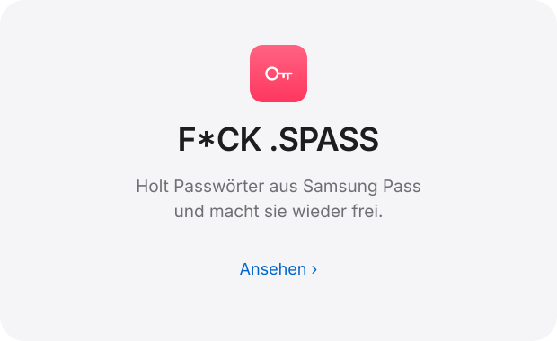
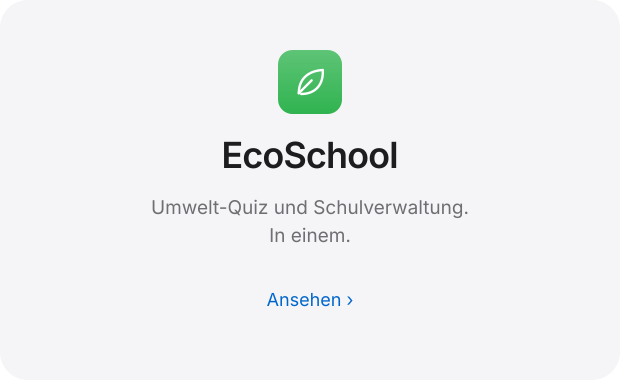
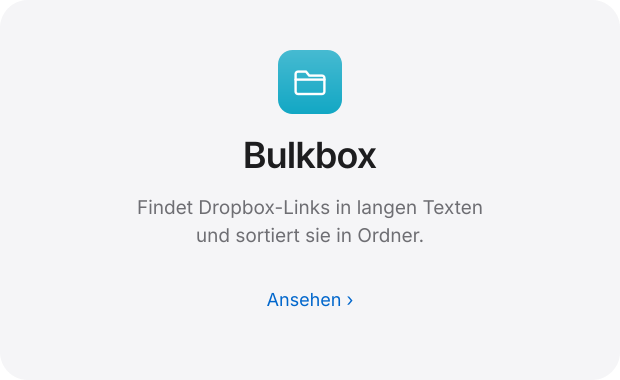
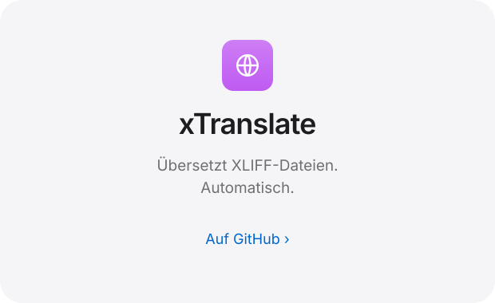
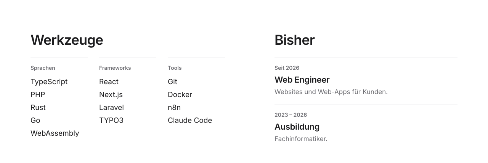
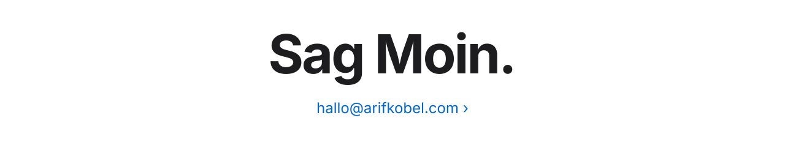

<a href="https://arifkobel.com">
  <picture>
    <source media="(prefers-color-scheme: dark)" srcset="assets/hero-dark.svg">
    
  </picture>
</a>

<a href="https://tintenfisch.app">
  <picture>
    <source media="(prefers-color-scheme: dark)" srcset="assets/tintenfisch-dark.svg">
    
  </picture>
</a>

<a href="https://arifkobel.com/prezzy">
  <picture>
    <source media="(prefers-color-scheme: dark)" srcset="assets/prezzy-dark.svg">
    
  </picture>
</a>

<a href="https://neatshot.kobel.click">
  <picture>
    <source media="(prefers-color-scheme: dark)" srcset="assets/neatshot-dark.svg">
    
  </picture>
</a>

<a href="https://fck-spass.kobel.click">
  <picture>
    <source media="(prefers-color-scheme: dark)" srcset="assets/fckspass-dark.svg">
    
  </picture>
</a>
<a href="https://ecoschool.develop.kobel.click">
  <picture>
    <source media="(prefers-color-scheme: dark)" srcset="assets/ecoschool-dark.svg">
    
  </picture>
</a>
<a href="https://bulkbox.kobel.click">
  <picture>
    <source media="(prefers-color-scheme: dark)" srcset="assets/bulkbox-dark.svg">
    
  </picture>
</a>
<a href="https://github.com/ArifKobel/xtranslate">
  <picture>
    <source media="(prefers-color-scheme: dark)" srcset="assets/xtranslate-dark.svg">
    
  </picture>
</a>

<picture>
  <source media="(prefers-color-scheme: dark)" srcset="assets/specs-dark.svg">
  
</picture>

 
 

<a href="mailto:hallo@arifkobel.com">
  <picture>
    <source media="(prefers-color-scheme: dark)" srcset="assets/footer-dark.svg">
    
  </picture>
</a>

